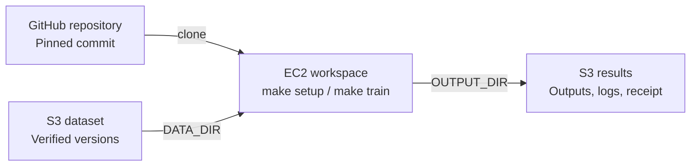
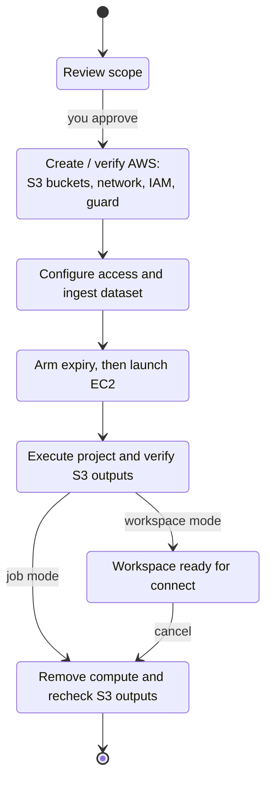

# ml-deployer

One command creates a bounded, ML-ready EC2 machine with persistent S3 storage,
a pinned toolbox, non-root terminal access and a provider-side expiry. You bring
an external ML repository and a dataset; this repository owns the machine, the
buckets, the identities and the safe lifetime.

**Install on Linux or macOS**, from a checkout:

```sh
git clone https://github.com/Bboissen/ml-deployer.git
cd ml-deployer
make
```

`make` prepares hash-pinned tools, signs you in to GitHub, asks for two things
(your GitHub repository and dataset), derives the rest through the GitHub API
and your AWS profile, saves a private project file and offers native AWS
sign-in. Your repository provides `make setup` and `make train`
([runtime contract](docs/operations/aws-deployer-quickstart.md#runtime-contract)). Completed
steps are skipped on rerun. A companion page at `http://127.0.0.1:8765/` shows
progress; it never logs in or deploys.

**From a laptop over SSH**, keep the checkout on the server and run
`make` there. It detects SSH and prints the tunnel command for your laptop and the link
to open in your browser; questions are still answered in the SSH terminal.

Then review and deploy from the same checkout:

```sh
./workspace doctor ~/aws-workspace/demo/project.json   # Ready / To do with the next command
./workspace ~/aws-workspace/demo/project.json          # prints the exact scope and its hash, asks once
./workspace ~/aws-workspace/demo/project.json status --wait 30
```

Deploy resolves the account, capacity, repository commit and dataset into an
immutable review and launches only after you type `deploy`. Automation passes
`--authorization "approve scope HASH"` with the hash that review printed.
`logs`, `connect`, `resume` and `cancel` take the same project file.

- `make` — start or resume guided setup
- `make REPO=owner/name DATASET=path` — set up without questions (browser logins only)
- `make clean` — remove interrupted tool builds; keep installed tools
- `make fclean` — also remove managed tools, the project settings and its AWS sign-in;
  keep the GitHub login, datasets and evidence
- `make re` — full clean, then reinstall tools and restart guided setup
- `make DEBUG=1` — show detailed diagnostics
- `make check` — run the offline test suite (developers)
- `make help` — list these commands

Follow the [first-use guide](docs/aws-setup-guide.html) or the one-page
[quickstart](docs/operations/aws-deployer-quickstart.md). The
[AWS account setup](docs/account-setup/aws.md) lists what the account owner
prepares. Status: release candidate `0.1.0-rc.1`; offline suites and a clean
Ubuntu container install pass, and the
[native acceptance cases](docs/operations/aws-native-acceptance.md) that still
need a real account run are listed there.

## How it works

The local controller turns a project file into a bounded AWS workspace. It
resolves the repository commit, inventories the dataset, selects compute and
shows the account, price and lifetime for approval. It then inspects and applies
saved OpenTofu plans bound to that approval.

**It provisions the AWS environment, including the S3 buckets.** On the first
deployment it creates the foundation in your existing AWS account; later
deployments verify and reuse that retained foundation.

The workload follows this path:



The controller ingests a local, S3 or HTTPS dataset into the project's S3 bucket
and verifies its object versions and checksums before launching compute. EC2
clones the pinned commit, stages the verified dataset as read-only `DATA_DIR`,
and runs your commands as a non-root user. Your repository owns ML dependencies
and logic; the deployer uploads declared `OUTPUT_DIR` files and execution records.

The **foundation** includes two separate private, encrypted, versioned S3 buckets:

- **State bucket:** OpenTofu infrastructure state.
- **Workload bucket:** datasets, outputs, logs and execution receipts in separate prefixes.

The dataset and results shown above use the same workload bucket. The deployer
also creates the network, scoped IAM permissions and expiry guard. A
per-workspace deadline is armed before launch permissions are created.
AWS terminates expired compute even if the controller is gone. Terminal access
uses Session Manager with no inbound
network rules; datasets, results and the foundation survive compute cleanup.

## Deployment lifecycle

The lifecycle separates preparation, execution and retention. Job mode runs
setup and training; workspace mode runs setup and leaves a terminal available.



`success` means setup and training passed, compute was removed, and the saved
outputs were verified again after removal. Datasets, outputs and the foundation
remain; deleting retained resources requires separate authorization.

The diagram shows normal completion. A workspace also ends at its fixed AWS
expiry; `resume` reconciles remaining controls and receipts afterward. Failures
and cancellation trigger owned-resource cleanup. If effects are uncertain,
recovery checks recorded ownership before continuing; it never silently
launches a second machine or reruns an interrupted job.

## Reading the stage messages

The diagram groups the work into broad phases. The terminal shows the smaller
steps inside those phases:

```text
stage artifacts    started
stage artifacts    completed
```

`started` means a step is beginning. `completed` means its result was recorded;
it does not mean training or the whole deployment succeeded. Progress goes to
stderr; the JSON result goes to stdout.

The steps run in this order:

| Stage | What it does |
| --- | --- |
| `artifacts` | Build the toolbox and expiry-watchdog ZIPs from pinned inputs and record their hashes. These are infrastructure packages; your ML dependencies are installed by your project's setup command. |
| `foundation` | On first deployment, create the state S3 bucket, workload S3 bucket, network, IAM permissions and expiry guard. On later deployments, verify and reuse them. No workspace EC2 instance is created yet. |
| `foundation-iam` (if needed) | Apply the permission tightening for a retained foundation that was included in the approved scope. |
| `repository` | Register a read-only GitHub deploy key and store its private half in Secrets Manager, or reuse an existing reference. Public repositories need no credential. EC2 cloning happens during `job`. |
| `access` (private repository only) | Grant or verify the workspace role's access to the selected repository secret. |
| `ingestion` | Stream the selected dataset to S3 or reuse matching content. Read exact object versions back and verify checksums before recording the dataset manifest. |
| `prepare` | Create the workspace identity, Session Manager documents and terminal grants, absolute expiry schedule and bounded launch role. The deadline must exist before launch permissions. |
| `launch` | Check the native guard, deadline and IAM readiness, then create the single reviewed EC2 instance within its launch window. |
| `job` | Clone the pinned commit, remove clone credentials, stage the verified dataset, and run non-root setup and training. Save declared outputs, logs and an execution receipt to S3. Workspace mode runs setup only. |
| `verify` | Independently read the saved receipt and output versions, check hashes, and bind them to the reviewed commit, dataset and instance. Report setup and training exit codes separately. |
| `cleanup` | Remove owned compute and temporary runner controls, and verify their absence, unless retaining a ready workspace. Recheck persisted outputs after compute deletion. |

**At `stage prepare started`,** the dataset is verified in S3 and the deployer
is setting up the machine's safety controls. EC2 has not launched and training
has not started. The next stages are `launch`, then `job`.

A stage marked `unknown` may have partially changed AWS resources. `resume`
checks what actually happened before continuing recovery; it never silently
repeats an interrupted launch or job. Completed stages are reused.

Use the same project file to inspect progress or recover:

```sh
./workspace ~/aws-workspace/demo/project.json status --wait 30
./workspace ~/aws-workspace/demo/project.json logs
./workspace ~/aws-workspace/demo/project.json resume
./workspace ~/aws-workspace/demo/project.json cancel
```

`status` and `logs` inspect progress; `resume` recovers an interrupted operation;
`cancel` requests cleanup. Keep ignored `evidence/` intact: it holds the approved
scope, saved plans and receipts needed for recovery. See the
[operations guide](docs/operations/aws-deploy-operation.md) for plan validation,
launch deadlines and recovery rules.

[Security](SECURITY.md) · [Contributing](CONTRIBUTING.md) · [Goals](goal/README.md) · [MIT license](LICENSE)
