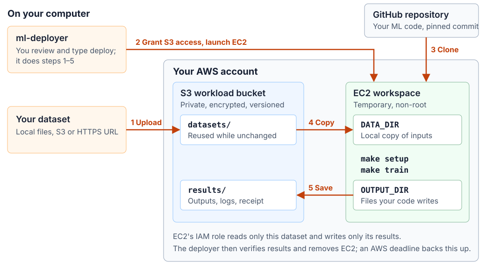

# ml-deployer

Run your ML project on AWS without wiring AWS yourself. Point it at a GitHub
repository and a dataset, review the plan and type `deploy`. The deployer
uploads your dataset to S3, gives a temporary EC2 machine access to exactly
that data, runs your code there and saves the results back to S3.



You never create buckets, IAM roles, EC2 credentials or copy commands. Your
code reads local files in `DATA_DIR` and writes to `OUTPUT_DIR`; the deployer
moves them to and from S3 and verifies every transfer.

## Start

On Linux or macOS:

```sh
git clone https://github.com/Bboissen/ml-deployer.git
cd ml-deployer
make
```

`make` installs tools, walks you through configuration and sign-in, then offers
to deploy. It saves your settings in `~/aws-workspace/demo/project.json` and
reuses completed steps. Your ML repository must provide
[`make setup` and `make train`](docs/operations/aws-deployer-quickstart.md#runtime-contract).

For later runs:

```sh
./workspace doctor ~/aws-workspace/demo/project.json  # check your setup
./workspace ~/aws-workspace/demo/project.json         # review, then type deploy
```

Prepare your [AWS account](docs/account-setup/aws.md) first. Over SSH, start
`make` on the server and follow its tunnel instructions for the companion
page. The page closes when `make` exits; use `./workspace guide --read-only`
to open it on its own.

See the [quickstart](docs/operations/aws-deployer-quickstart.md) for more options,
or run `make help`.

To delete saved results, use `make s3-clean`; add `DRY_RUN=1` to preview or
`S3_DATASETS=1` to include shared inputs. Deletion is permanent and requires
typed confirmation. Buckets and infrastructure state remain.
See [S3 cleanup](docs/operations/aws-deployer-quickstart.md#s3-cleanup).

## What happens when you deploy

1. **Review.** The deployer shows one plan: account, commit, dataset, machine
   size, hourly price and maximum lifetime. Typing `deploy` approves exactly that.
2. **Upload your dataset to S3.** A local file or folder, an S3 source or a
   public HTTPS URL. Unchanged data reuses the verified upload.
3. **Connect EC2 to S3.** The first run creates the buckets, network,
   permissions and expiry guard; later runs reuse them. The machine's IAM role
   can read only this dataset and write only this run's results.
4. **Run your code.** EC2 clones your repository, copies the data into
   `DATA_DIR` and runs `make setup` then `make train` as a non-root user.
5. **Save results.** Declared outputs, logs and an execution receipt go to S3
   and are verified. Then EC2 is removed; your storage stays. AWS enforces the
   deadline even if you disconnect.

Datasets and results live in a private, encrypted, versioned **workload
bucket**: inputs under `datasets/<source>/`, outputs under
`results/<workspace>/`, with UTC timestamps for each version or run.
OpenTofu state has a separate **state bucket**. See
[bucket names and storage paths](docs/operations/aws-deployer-quickstart.md#7-outputs-and-cleanup).

For an interactive session, choose `workspace` mode: it runs setup without
training. Use `connect` to open a Session Manager terminal; no inbound ports
are needed. The machine stays until you run `cancel` or it expires.

## Progress and operations

```sh
./workspace ~/aws-workspace/demo/project.json status --wait 30
```

Replace `status --wait 30` with `logs`, `connect`, `resume` or `cancel` as needed.
Keep `evidence/` for recovery; Git ignores it. The
[operations guide](docs/operations/aws-deploy-operation.md) covers approvals,
recovery and cleanup.

<details>
<summary>Deployment log stages</summary>

`started` begins a step; `completed` records its result, not overall job success.
`unknown` requires reconciliation with `resume`. Progress is on stderr; results
are JSON on stdout.

| Stage | Work performed |
| --- | --- |
| `artifacts` | Build and hash the toolbox and expiry-watchdog packages. |
| `foundation` | Create or verify the two S3 buckets, network, IAM and expiry guard. |
| `foundation-iam` (if needed) | Apply the reviewed permission tightening to a retained foundation. |
| `repository` | Create/reuse a read-only GitHub deploy key stored in Secrets Manager; public repositories need none. |
| `access` (private repo) | Grant the workspace role access to its repository secret. |
| `ingestion` | Upload/reuse the dataset; verify exact S3 versions and checksums. |
| `prepare` | Create workspace permissions, terminal access and expiry controls. Data is verified; EC2 has not launched yet. |
| `launch` | Check guard readiness and launch the reviewed instance. |
| `job` | Clone, remove clone credentials, stage data, run setup/training, and persist outputs. |
| `verify` | Independently check output versions, execution receipt and exit codes. |
| `cleanup` | Remove owned compute and temporary controls; recheck saved outputs. |

</details>

Release candidate `0.1.0-rc.1`; see [native acceptance status](docs/operations/aws-native-acceptance.md).

[Security](SECURITY.md) · [Contributing](CONTRIBUTING.md) · [MIT license](LICENSE)
