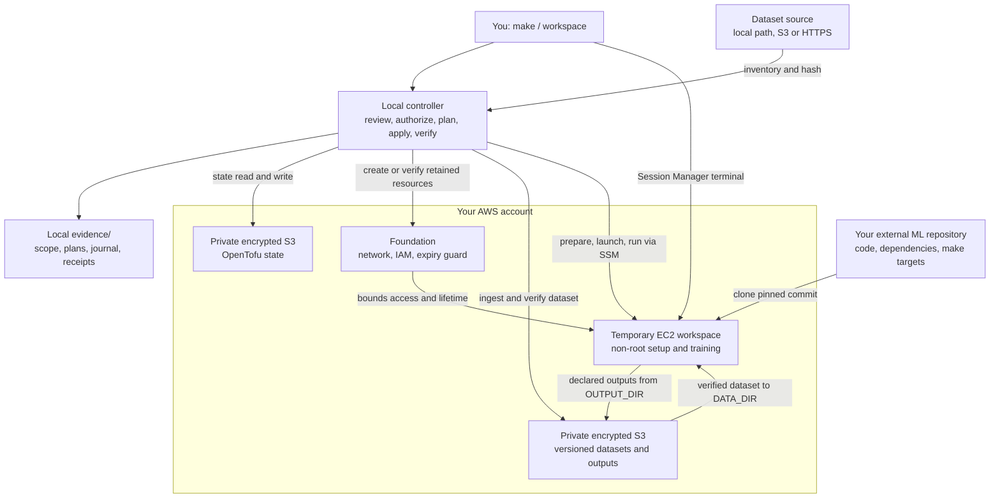
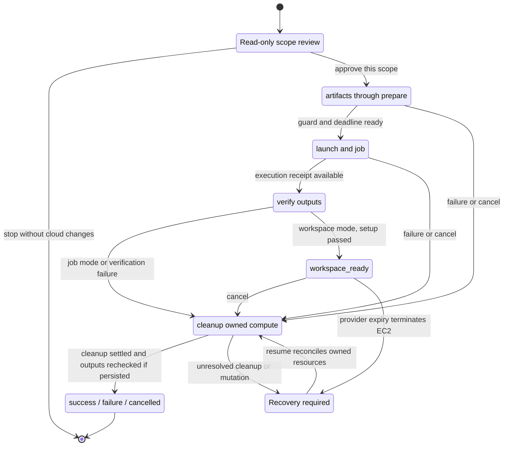

# ml-deployer

One command creates a bounded, ML-ready EC2 machine with persistent S3 storage,
a pinned toolbox, non-root terminal access and a provider-side expiry. You bring
an external ML repository and a dataset; this repository owns the machine, the
buckets, the identities and the safe lifetime.

**Install on Linux or macOS**, from a checkout:

```sh
git clone https://github.com/Bboissen/ml-deployer.git
cd ml-deployer
make
```

`make` prepares hash-pinned tools, signs you in to GitHub, asks for two things
(your GitHub repository and dataset), derives the rest through the GitHub API
and your AWS profile, saves a private project file and offers native AWS
sign-in. Your repository provides `make setup` and `make train`
([runtime contract](docs/operations/aws-deployer-quickstart.md#runtime-contract)). Completed
steps are skipped on rerun. A companion page at `http://127.0.0.1:8765/` shows
progress; it never logs in or deploys.

**From a laptop over SSH**, keep the checkout on the server and run
`make` there. It detects SSH and prints the tunnel command for your laptop and the link
to open in your browser; questions are still answered in the SSH terminal.

Then review and deploy from the same checkout:

```sh
./workspace doctor ~/aws-workspace/demo/project.json   # Ready / To do with the next command
./workspace ~/aws-workspace/demo/project.json          # prints the exact scope and its hash, asks once
./workspace ~/aws-workspace/demo/project.json status --wait 30
```

Deploy resolves the account, capacity, repository commit and dataset into an
immutable review and launches only after you type `deploy`. Automation passes
`--authorization "approve scope HASH"` with the hash that review printed.
`logs`, `connect`, `resume` and `cancel` take the same project file.

- `make` — start or resume guided setup
- `make REPO=owner/name DATASET=path` — set up without questions (browser logins only)
- `make clean` — remove interrupted tool builds; keep installed tools
- `make fclean` — also remove managed tools, the project settings and its AWS sign-in;
  keep the GitHub login, datasets and evidence
- `make re` — full clean, then reinstall tools and restart guided setup
- `make DEBUG=1` — show detailed diagnostics
- `make check` — run the offline test suite (developers)
- `make help` — list these commands

Follow the [first-use guide](docs/aws-setup-guide.html) or the one-page
[quickstart](docs/operations/aws-deployer-quickstart.md). The
[AWS account setup](docs/account-setup/aws.md) lists what the account owner
prepares. Status: release candidate `0.1.0-rc.1`; offline suites and a clean
Ubuntu container install pass, and the
[native acceptance cases](docs/operations/aws-native-acceptance.md) that still
need a real account run are listed there.

## How it works

The controller runs on your laptop or SSH server. It reviews the exact AWS
account, repository commit, dataset, machine, price and lifetime before making
cloud changes. After your scope-bound approval, it builds and checks saved
OpenTofu plans, provisions the workspace, runs your project and verifies its
outputs.



The external ML repository owns the dependencies and ML logic. On EC2, its
commands receive a verified, read-only `DATA_DIR` and an `OUTPUT_DIR` whose
declared files are persisted to S3. Terminal access uses AWS Systems Manager
(SSM) Session Manager with no inbound network rules. The local companion page
only displays progress.

## Deployment lifecycle



In the default **job** mode, every deployment runs setup and training, persists
outputs and removes its compute. `success` requires successful setup and training,
verified outputs, successful cleanup and another output check after compute
deletion. In **workspace** mode, successful setup leaves the machine available
for `connect` until `cancel` or its fixed provider-side expiry. AWS enforces
expiry even if the controller disconnects; `resume` reconciles any remaining
owned resources and receipts. Datasets, outputs, state and the foundation are
retained; deleting retained resources requires separate authorization.

## Reading the stage messages

Progress lines are journal events, written to stderr; stdout carries the JSON
result. For example:

```text
stage artifacts    started
stage artifacts    completed
stage foundation   started
stage foundation   completed
...
stage prepare      started
```

`started` records the intent before work begins; `completed` records that stage's
result. Completion of a stage does not mean the whole deployment or training
succeeded. Stages run in this order, with the conditional ones shown below:

| Stage | What happens before `completed` |
| --- | --- |
| `artifacts` | Build the local toolbox and expiry-watchdog ZIPs, install hash-locked watchdog dependencies and record artifact hashes. These are infrastructure artifacts; your ML dependencies come from your repository's setup command. |
| `foundation` | Create the state/bootstrap and platform resources, or verify a retained foundation: separate state and workload buckets, network, IAM and provider expiry guard. No EC2 workspace is launched yet. |
| `foundation-iam` (if needed) | Apply the exact retained deployer-policy tightening included in this review. |
| `repository` | Resolve repository credentials: register a read-only deploy key and store its private half in Secrets Manager for new private access, reuse an existing reference, or do nothing for a public repository. The EC2 checkout happens during `job`. |
| `access` (private repository only) | Grant the workspace role access to the selected repository secret, or verify the existing grant. |
| `ingestion` | Stream the selected dataset into the workload bucket, or reuse matching content after verification. Read exact S3 object versions back and verify hashes; seal a versioned manifest before compute can launch. |
| `prepare` | Apply runner controls: workspace identity/profile, SSM documents and terminal grants, the absolute expiry schedule and a bounded launch role. The deadline exists before launch permissions; this stage creates no EC2 instance. |
| `launch` | Check native guard, deadline and IAM readiness, then create the single reviewed EC2 instance within its launch window. |
| `job` | Wait for guest readiness, clone the pinned commit, remove clone credentials, stage and verify the dataset, then run non-root setup and training. Workspace mode runs setup only. Persist declared outputs, bounded logs and an execution receipt to S3. |
| `verify` | Independently read the execution receipt and output versions, check their hashes and bind them to this instance, repository commit and dataset. Setup and training exit codes are reported separately. |
| `cleanup` | Unless retaining a ready workspace, retire launch access, delete owned compute and runner controls, and verify their absence. It also runs after failures; it can complete with nothing to delete. Persisted outputs are checked again afterward. |

At `stage prepare started`, ingestion has completed and the controller is
applying the runner's safety controls. Training has not started. The fixed
five-minute launch window and maximum lifetime begin when runner preparation
begins; preparation time consumes that allowance. Launch follows successful
preparation and readiness checks, with no extra scheduling buffer.

A stage can become `unknown` after an error: its cloud effects may be partial.
The journal also records controller interruptions and the final operation
outcome. Completed stages are reused on resume; uncertain mutations must be
reconciled against owned resources. An interrupted launch or job is never
silently replayed.

Use the same project file to inspect progress or recover:

```sh
./workspace ~/aws-workspace/demo/project.json status --wait 30
./workspace ~/aws-workspace/demo/project.json logs
./workspace ~/aws-workspace/demo/project.json resume
./workspace ~/aws-workspace/demo/project.json cancel
```

`status` and `logs` inspect the operation; `resume` reconciles it and `cancel`
requests cleanup of its owned compute. Keep ignored `evidence/` intact: it binds
recovery to the approved scope, saved plans and exact resource ownership. See
[deployment and recovery details](docs/operations/aws-deploy-operation.md).

[Security](SECURITY.md) · [Contributing](CONTRIBUTING.md) · [Goals](goal/README.md) · [MIT license](LICENSE)
