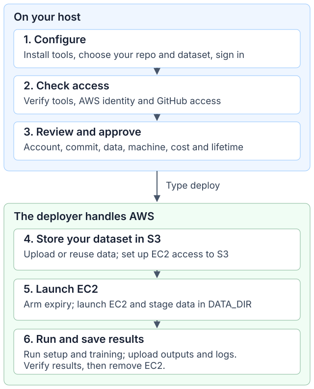
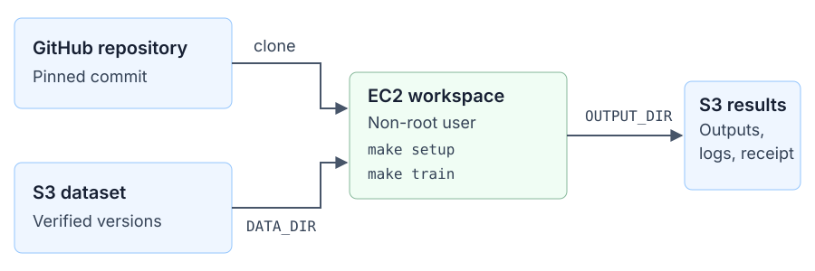

# ml-deployer

Run your ML project in your own AWS account. Choose a GitHub repository and a
dataset; after you approve deployment, the deployer uploads the data to S3,
connects EC2 to it, runs your code and saves the results back to S3.
It handles storage, permissions, data transfers and machine cleanup for you.

## Start

On Linux or macOS:

```sh
git clone https://github.com/Bboissen/ml-deployer.git
cd ml-deployer
make
```

`make` installs tools, walks you through configuration and sign-in, then offers
to deploy. It saves your settings in `~/aws-workspace/demo/project.json` and
reuses completed steps. Your ML repository must provide
[`make setup` and `make train`](docs/operations/aws-deployer-quickstart.md#runtime-contract).

For later runs:

```sh
./workspace doctor ~/aws-workspace/demo/project.json  # check your setup
./workspace ~/aws-workspace/demo/project.json         # review, then type deploy
```

Prepare your [AWS account](docs/account-setup/aws.md) first. Over SSH, start
`make` on the server and follow its tunnel instructions for the companion
page. The page closes when `make` exits; use `./workspace guide --read-only`
to open it on its own.

See the [quickstart](docs/operations/aws-deployer-quickstart.md) for more options,
or run `make help`.

To delete saved results, use `make s3-clean`; add `DRY_RUN=1` to preview or
`S3_DATASETS=1` to include shared inputs. Deletion is permanent and requires
typed confirmation. Buckets and infrastructure state remain.
See [S3 cleanup](docs/operations/aws-deployer-quickstart.md#s3-cleanup).

## How deployment works



The first deployment creates the buckets, network, permissions and expiry guard;
later runs reuse them. AWS enforces the deadline even if you disconnect. After a
job, the machine is removed and your storage stays.

## Code and data flow



After approval, the deployer handles the full path:

1. **Upload your dataset to S3.** It accepts a local file or folder, an S3 source
   or a public HTTPS URL. Unchanged data reuses the verified upload.
2. **Connect EC2 to your storage.** It creates the permissions, checks the data
   and copies it onto the machine. Your code reads local files in `DATA_DIR`.
3. **Save results back to S3.** Your code writes to `OUTPUT_DIR`; the deployer
   uploads the declared outputs, logs and execution receipt, then verifies them.

Your project supplies dependencies and training code. The deployer handles the
AWS wiring—no manual bucket setup, EC2 credentials or copy commands.
Datasets and results stay in a private, encrypted, versioned **workload bucket**;
OpenTofu state has a separate **state bucket**.

Find inputs under `datasets/<source>/` and outputs under `results/<workspace>/`,
with UTC timestamps for each version or run. See
[bucket names and storage paths](docs/operations/aws-deployer-quickstart.md#7-outputs-and-cleanup).

For an interactive session, choose `workspace` mode: it runs setup without
training. Use `connect` to open a Session Manager terminal; no inbound ports
are needed. The machine stays until you run `cancel` or it expires.

## Progress and operations

```sh
./workspace ~/aws-workspace/demo/project.json status --wait 30
```

Replace `status --wait 30` with `logs`, `connect`, `resume` or `cancel` as needed.
Keep `evidence/` for recovery; Git ignores it. The
[operations guide](docs/operations/aws-deploy-operation.md) covers approvals,
recovery and cleanup.

<details>
<summary>Deployment log stages</summary>

`started` begins a step; `completed` records its result, not overall job success.
`unknown` requires reconciliation with `resume`. Progress is on stderr; results
are JSON on stdout.

| Stage | Work performed |
| --- | --- |
| `artifacts` | Build and hash the toolbox and expiry-watchdog packages. |
| `foundation` | Create or verify the two S3 buckets, network, IAM and expiry guard. |
| `foundation-iam` (if needed) | Apply the reviewed permission tightening to a retained foundation. |
| `repository` | Create/reuse a read-only GitHub deploy key stored in Secrets Manager; public repositories need none. |
| `access` (private repo) | Grant the workspace role access to its repository secret. |
| `ingestion` | Upload/reuse the dataset; verify exact S3 versions and checksums. |
| `prepare` | Create workspace permissions, terminal access and expiry controls. Data is verified; EC2 has not launched yet. |
| `launch` | Check guard readiness and launch the reviewed instance. |
| `job` | Clone, remove clone credentials, stage data, run setup/training, and persist outputs. |
| `verify` | Independently check output versions, execution receipt and exit codes. |
| `cleanup` | Remove owned compute and temporary controls; recheck saved outputs. |

</details>

Release candidate `0.1.0-rc.1`; see [native acceptance status](docs/operations/aws-native-acceptance.md).

[Security](SECURITY.md) · [Contributing](CONTRIBUTING.md) · [Goals](goal/README.md) · [MIT license](LICENSE)
