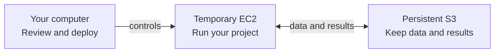
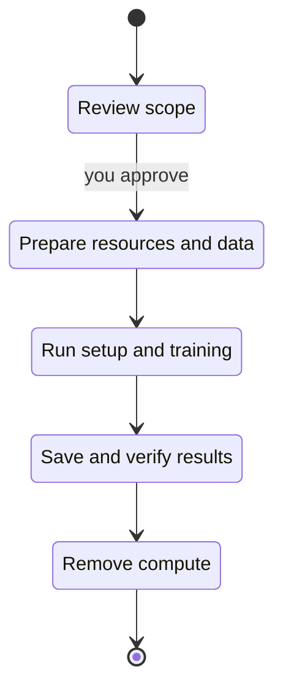

# ml-deployer

One command creates a bounded, ML-ready EC2 machine with persistent S3 storage,
a pinned toolbox, non-root terminal access and a provider-side expiry. You bring
an external ML repository and a dataset; this repository owns the machine, the
buckets, the identities and the safe lifetime.

**Install on Linux or macOS**, from a checkout:

```sh
git clone https://github.com/Bboissen/ml-deployer.git
cd ml-deployer
make
```

`make` prepares hash-pinned tools, signs you in to GitHub, asks for two things
(your GitHub repository and dataset), derives the rest through the GitHub API
and your AWS profile, saves a private project file and offers native AWS
sign-in. Your repository provides `make setup` and `make train`
([runtime contract](docs/operations/aws-deployer-quickstart.md#runtime-contract)). Completed
steps are skipped on rerun. A companion page at `http://127.0.0.1:8765/` shows
progress; it never logs in or deploys.

**From a laptop over SSH**, keep the checkout on the server and run
`make` there. It detects SSH and prints the tunnel command for your laptop and the link
to open in your browser; questions are still answered in the SSH terminal.

Then review and deploy from the same checkout:

```sh
./workspace doctor ~/aws-workspace/demo/project.json   # Ready / To do with the next command
./workspace ~/aws-workspace/demo/project.json          # prints the exact scope and its hash, asks once
./workspace ~/aws-workspace/demo/project.json status --wait 30
```

Deploy resolves the account, capacity, repository commit and dataset into an
immutable review and launches only after you type `deploy`. Automation passes
`--authorization "approve scope HASH"` with the hash that review printed.
`logs`, `connect`, `resume` and `cancel` take the same project file.

- `make` — start or resume guided setup
- `make REPO=owner/name DATASET=path` — set up without questions (browser logins only)
- `make clean` — remove interrupted tool builds; keep installed tools
- `make fclean` — also remove managed tools, the project settings and its AWS sign-in;
  keep the GitHub login, datasets and evidence
- `make re` — full clean, then reinstall tools and restart guided setup
- `make DEBUG=1` — show detailed diagnostics
- `make check` — run the offline test suite (developers)
- `make help` — list these commands

Follow the [first-use guide](docs/aws-setup-guide.html) or the one-page
[quickstart](docs/operations/aws-deployer-quickstart.md). The
[AWS account setup](docs/account-setup/aws.md) lists what the account owner
prepares. Status: release candidate `0.1.0-rc.1`; offline suites and a clean
Ubuntu container install pass, and the
[native acceptance cases](docs/operations/aws-native-acceptance.md) that still
need a real account run are listed there.

## How it works

You provide a GitHub repository and a dataset. The deployer creates a temporary
machine in your AWS account, runs your project's setup and training commands,
and keeps the results in S3 after the machine is removed.

Three parts have distinct jobs:



Your computer (or SSH server) runs `make` and `./workspace`. It asks you to
approve the account, commit, dataset, machine, price and lifetime before making
cloud changes. The EC2 machine runs your repository's code and dependencies as
a non-root user. Its commands read the verified dataset from `DATA_DIR` and
write declared results to `OUTPUT_DIR`; the deployer persists those results to S3.

Compute is temporary; data is persistent. Private, encrypted S3 storage holds
datasets and results; infrastructure state has its own bucket. AWS enforces the
machine's expiry even if your computer disconnects. The supporting network,
permissions and expiry guard are retained for reuse.

## Deployment lifecycle

The normal path in the default **job** mode is:



`success` means setup and training passed, compute was removed, and the saved
outputs were verified again after removal. Datasets, outputs and the foundation
remain; deleting retained resources requires separate authorization.

In **workspace** mode, setup runs without training and the machine stays
available for `connect` until `cancel` or expiry. Failures and cancellation also
trigger cleanup; recovery details are in the
[operations guide](docs/operations/aws-deploy-operation.md).

## Reading the stage messages

The diagram groups the work into broad phases. The terminal shows the smaller
steps inside those phases:

```text
stage artifacts    started
stage artifacts    completed
```

`started` means a step is beginning. `completed` means its result was recorded;
it does not mean training or the whole deployment succeeded. Progress goes to
stderr; the JSON result goes to stdout.

The steps run in this order:

| Stage | What it does |
| --- | --- |
| `artifacts` | Package the toolbox and automatic-expiry code locally. Your ML dependencies are installed later by your project's setup command. |
| `foundation` | Create or verify reusable AWS storage, network, permissions and the expiry guard. |
| `foundation-iam` (if needed) | Tighten permissions on an existing foundation as included in the approved scope. |
| `repository` | Prepare or reuse credentials for a private repository; public repositories need none. Cloning on EC2 happens during `job`. |
| `access` (private repository only) | Allow the workspace role to read the selected repository credential. |
| `ingestion` | Copy the selected dataset into S3, or verify a reusable copy, and check its integrity. |
| `prepare` | Set up the workspace permissions, terminal access and expiry deadline before EC2 can launch. |
| `launch` | Check that the safety controls are ready, then create the reviewed EC2 machine. |
| `job` | Clone the pinned commit, stage the dataset, run setup and training, and save declared outputs and execution records to S3. Workspace mode runs setup only. |
| `verify` | Independently check the saved outputs and execution records. Setup and training exit codes are reported separately. |
| `cleanup` | Remove owned compute and its temporary controls, unless retaining a ready workspace. Saved outputs are checked again afterward. |

**At `stage prepare started`,** the dataset is verified in S3 and the deployer
is setting up the machine's safety controls. EC2 has not launched and training
has not started. The next stages are `launch`, then `job`.

A stage marked `unknown` may have partially changed AWS resources. `resume`
checks what actually happened before continuing recovery; it never silently
repeats an interrupted launch or job. Completed stages are reused.

Use the same project file to inspect progress or recover:

```sh
./workspace ~/aws-workspace/demo/project.json status --wait 30
./workspace ~/aws-workspace/demo/project.json logs
./workspace ~/aws-workspace/demo/project.json resume
./workspace ~/aws-workspace/demo/project.json cancel
```

`status` and `logs` inspect progress; `resume` recovers an interrupted operation;
`cancel` requests cleanup. Keep ignored `evidence/` intact: it holds the approved
scope, saved plans and receipts needed for recovery. See the
[operations guide](docs/operations/aws-deploy-operation.md) for plan validation,
launch deadlines and recovery rules.

[Security](SECURITY.md) · [Contributing](CONTRIBUTING.md) · [Goals](goal/README.md) · [MIT license](LICENSE)
