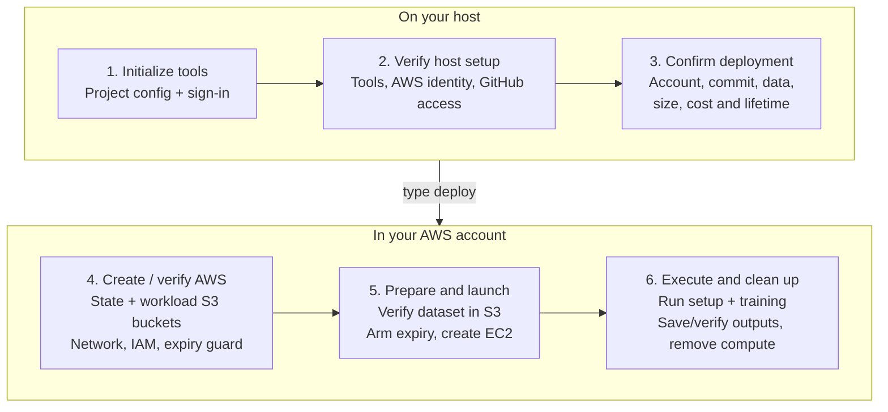
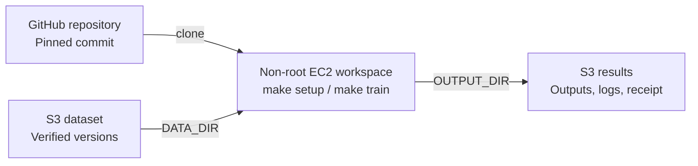

# ml-deployer

Provision an ML workspace in your AWS account: EC2 compute, persistent S3 storage,
a pinned toolbox and automatic expiry. You bring the GitHub repository and dataset;
this repo manages infrastructure, access and cleanup.

## Start

On Linux or macOS:

```sh
git clone https://github.com/Bboissen/ml-deployer.git
cd ml-deployer
make
```

`make` installs pinned tools, asks for your repository and dataset, saves
`~/aws-workspace/demo/project.json`, and guides GitHub/AWS sign-in. Valid completed
steps are reused. Your repository supplies
[`make setup` and `make train`](docs/operations/aws-deployer-quickstart.md#runtime-contract).

```sh
./workspace doctor ~/aws-workspace/demo/project.json  # verify tools, config and access
./workspace ~/aws-workspace/demo/project.json         # display deployment details; type deploy to approve
```

Use an [AWS account prepared for deployment](docs/account-setup/aws.md).
Over SSH, run `make` on the server; it prints the tunnel command for the
read-only companion page. See the [quickstart](docs/operations/aws-deployer-quickstart.md)
for configuration, automation and setup/clean commands; `make help` lists targets.

## From host setup to AWS execution



The first deployment creates the AWS foundation; later ones verify and reuse it.
The deadline is armed before launch. AWS enforces expiry even if your host
disconnects. Compute is removed after a job; the buckets and foundation remain.

## Code and data flow



Datasets and results share the private, encrypted, versioned **workload bucket**.
OpenTofu state has a separate **state bucket**. Your project owns dependencies
and ML logic; the deployer verifies dataset versions and persisted outputs.

In `workspace` mode, setup runs without training; use `connect` for a Session
Manager terminal with no inbound network rules. Compute stays until `cancel`
or expiry.

## Progress and operations

```sh
./workspace ~/aws-workspace/demo/project.json status --wait 30
```

Use `logs`, `connect`, `resume` or `cancel` in place of `status --wait 30`.
Keep ignored `evidence/` intact for recovery. See the
[operations guide](docs/operations/aws-deploy-operation.md) for approval hashes,
failure handling and cleanup rules.

<details>
<summary>Deployment log stages</summary>

`started` begins a step; `completed` records its result, not overall job success.
`unknown` requires reconciliation with `resume`. Progress is on stderr; results
are JSON on stdout.

| Stage | Work performed |
| --- | --- |
| `artifacts` | Build and hash the toolbox and expiry-watchdog packages. |
| `foundation` | Create or verify the two S3 buckets, network, IAM and expiry guard. |
| `foundation-iam` (if needed) | Apply the reviewed permission tightening to a retained foundation. |
| `repository` | Create/reuse a read-only GitHub deploy key stored in Secrets Manager; public repositories need none. |
| `access` (private repo) | Grant the workspace role access to its repository secret. |
| `ingestion` | Upload/reuse the dataset; verify exact S3 versions and checksums. |
| `prepare` | Create workspace permissions, terminal access and expiry controls. Data is verified; EC2 has not launched yet. |
| `launch` | Check guard readiness and launch the reviewed instance. |
| `job` | Clone, remove clone credentials, stage data, run setup/training, and persist outputs. |
| `verify` | Independently check output versions, execution receipt and exit codes. |
| `cleanup` | Remove owned compute and temporary controls; recheck saved outputs. |

</details>

Release candidate `0.1.0-rc.1`; see [native acceptance status](docs/operations/aws-native-acceptance.md).

[Security](SECURITY.md) · [Contributing](CONTRIBUTING.md) · [Goals](goal/README.md) · [MIT license](LICENSE)
