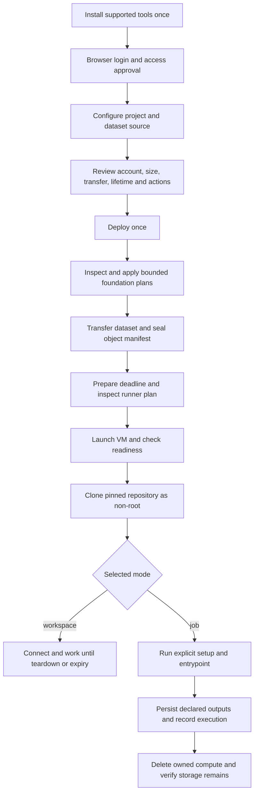

# AWS deployment automation feasibility

An AWS deployment driven by a short configuration and one Deploy action is
feasible. Most of the execution already exists. The remaining work is to make
onboarding, configuration discovery, dataset transfer and ordinary project
execution as automatic as the existing bounded acceptance run.

Assessment date: 9 October 2026. Source baseline: merged `main` at
`fd640b69d5018e27b8bdb2f896186a6997777b55`. This is a source and saved-evidence
audit, not a new live inventory or deployment. The original working directory
was still at `4ae5f39` with uncommitted changes; conclusions drawn only from that
checkout miss the workspace implementation merged in PRs 20, 22, 23 and 24.

Read the [migration goals](../goal/workspace/07_AWS_AUTOMATION.md),
[implementation handoff](../goal/workspace/08_AWS_AUTOMATION_HANDOFF.md) and
[HTML setup guide](aws-setup-guide.html).

## What already works

[PR 24](https://github.com/Bboissen/Ray_terraform/pull/24), merged on 9 October,
delivers a single-configuration AWS job controller. It prepares scoped access
and a lease, provisions EC2, waits for bootstrap, clones a pinned private GitHub
repository as a non-root user, invokes Make, checks versioned S3 output, removes
compute and checks the same output again. Each saved plan is inspected and
bound to the user's existing task authorization without another prompt per phase.

The saved native run completed at 21:37:27 UTC on 9 October with `status=success`,
`job_success=true`, `cleanup_success=true` and
`verified_after_compute_deletion=true`. Its source was `4ea7ab0`, its instance
was `r8i.2xlarge`, and its external repository produced the expected tiny
NumPy/pandas result. Evidence is retained in the toolbox worktree under
`evidence/aws/autonomous-training-finalization/native-e2e-20261009T212720670778Z/run/result.json`.
This proves that bounded example on the configured account; it does not prove
arbitrary dataset, account, region or project compatibility. Interactive terminal
acceptance is separate from the successful SSM job path.

| Existing component | Reuse in the target |
| --- | --- |
| [Workspace command](../scripts/aws/workspace.sh) and [controller](../scripts/aws/workspace-e2e.py) | Execution stages, scope validation, failure reporting and cleanup |
| [Target boundary](../scripts/aws/workspace-target.sh) | Bind CLI/SDK operations to the selected identity, account and region |
| [Storage selection](../scripts/aws/workspace-storage.sh) | Deterministic names, create/reuse decisions and native S3 handoff |
| [Lifecycle](../scripts/aws/workspace-lifecycle.sh) | Saved-plan checks, dependencies, immutable evidence and task authorization |
| AWS `bootstrap/workspace`, `platform/workspace`, `runner/workspace` roots | Separate state, persistent platform and disposable compute ownership |
| [Shared workspace schema](../shared/workspace/schema.json) | Provider-neutral request, handoff and readiness vocabulary |
| Non-root toolbox, pre-armed deadline and recurring watchdog | Installation, provider-native access and independent expiry |

## How many interactions can be automated

Of these 16 explicitly defined workflow steps, **12 can be automatic, two are
assisted authentication/access steps, and two are user decisions**. This counts
target workflow steps, not implementation completeness or percentage of effort.
It assumes an existing funded account and authority to create the selected
resources. Account signup, payment verification, organization policy exceptions,
new quota approvals and unavailable repository rights remain external prerequisites.

| Step | Target behavior | Remaining human involvement |
| --- | --- | --- |
| 1. Install and verify supported local tools | Automatic | OS elevation only if the chosen installation method needs it |
| 2. Establish AWS authentication | Assisted | Browser sign-in, MFA, account/role selection; repeat after session expiry |
| 3. Establish GitHub access | Assisted | Browser consent and repository/organization authorization when needed |
| 4. Choose deployment intent | User decision | Provider, project, dataset, repository/ref, execution mode, size/lifetime |
| 5. Discover cloud facts | Automatic | Resolve ambiguous account/region choices; do not guess |
| 6. Generate names and configuration | Automatic | Optional friendly names and explicit overrides |
| 7. Inspect exact plans and record authorization | Automatic | Enforce the previously selected scope; stop on material expansion |
| 8. Create or reuse the persistent foundation | Automatic | Existing-resource adoption or deletion requires a disposition decision |
| 9. Configure scoped runtime and repository access | Automatic | Requires the rights established during onboarding |
| 10. Inspect and upload/copy the dataset | Automatic | Source access and transfer scope must already be selected |
| 11. Provision a guarded workspace | Automatic | Unavailable capacity is an explicit outcome, not a silent fallback |
| 12. Clone, install and invoke the chosen entrypoint | Automatic | Project supplies its commands and dependency locks |
| 13. Collect bounded progress and logs | Automatic | Action only on a meaningful failure or expired login |
| 14. Record execution and durable-output facts | Automatic | ML result correctness remains with the external project |
| 15. Tear down owned compute and verify retention | Automatic | Job mode; workspace mode tears down on explicit request or expiry |
| 16. Authorize cost, transfer and code execution | User decision | One concrete scope at Deploy; no repeated routine confirmations |

For a configured project with valid sessions, steps 4 and 16 can become one
review screen and Deploy action. A completely new user still needs onboarding.
The software can open login flows; it cannot supply MFA or grant itself rights.
[AWS login](https://docs.aws.amazon.com/cli/latest/userguide/cli-configure-sign-in.html)
and [GitHub CLI login](https://cli.github.com/manual/gh_auth_login) support these
assisted flows.

The user selected automatic dependency installation and execution of the chosen
entrypoint on every Deploy, with Linux and macOS installers in the first release.
Job mode is therefore the default; interactive workspace mode is optional.

## Current gaps that prevent a generic one click experience

| Finding | Evidence in merged source | Required change |
| --- | --- | --- |
| Foundation setup is tied to the original account/project | `workspace-lifecycle.sh` foundation packet and scope checks pin the account, Demo names and zone | Generate a reviewed target and ownership map from selected inputs; retain strict scope checks |
| Region, machine and operator are source constants | `workspace.sh` pins `us-east-1`, `r8i.2xlarge`, a fixed capacity object and a 15–60 minute lease; runner `terminal.tf` grants a named IAM user | Versioned supported profiles; exact discovered identities; separate IAM-user and federated-role access paths |
| Configuration requires internal artifacts | `workspace.example.json` asks for backend keys, inventories, ARNs, foundation receipt paths, output hash and artifact paths | Produce these from outputs and an operation registry; expose a short user configuration |
| Dataset upload is absent from the job journey | E2E preflight expects an already-versioned S3 object | Add explicit local, S3 and HTTPS transfer adapters before compute launch |
| Dataset checking is designed for a tiny fixture | `object_bytes` defaults to 1 MiB and preflight downloads the complete input through it | Stream large data; use an object manifest and bounded verification, not whole-dataset RAM loading |
| Execution is Make-only and SSH-only in the unattended path | Configuration accepts one Make target; E2E preflight requires a runtime SSH credential even though the interactive configuration also accepts HTTPS | Support public HTTPS and reviewed private access; explicit setup/run argument arrays |
| Production success is coupled to acceptance output | Job config requires an expected result SHA and dependency-lock SHA; verifier requires the fixture provenance shape | Separate infrastructure/execution/transfer outcomes from optional deterministic acceptance checks |
| Any live EC2 blocks the acceptance preflight | It requires no reservations and no pagination token across the region | Paginated ownership-aware checks, quota accounting and per-workspace exclusion |
| Local installer and configurator are missing | Guest installer exists, but workstation prerequisites/configuration remain manual | Idempotent operator installer, login assistant and config generator |
| Distribution and hosted execution are missing | No `.github` workflow in this baseline | Offline CI/release packaging first; optional OIDC workflow after local acceptance |
| Status prose lags implementation | README/goals still say clone and S3 acceptance are pending | Cite the accepted job evidence while keeping generic/interactive claims distinct |

The lifetime gap described in the old batch audit must not be reintroduced:
the newer workspace launch already depends on prepared deadline controls and
checks the persistent watchdog. Preserve those controls. The retained design
uses a shared Lambda concurrency pool; provider outages or pool contention can
delay termination. It is a runtime safeguard, not a guaranteed currency cap.

## Proposed operator architecture

Keep OpenTofu as the infrastructure owner. Put a small user interface around
the existing controller instead of maintaining a second resource provisioner.
The following names describe proposed interfaces, not commands shipped today.

One Deploy action authorizes a bounded operation: account/region/project,
allowed resource classes, selected size, lifetime, number of launches, dataset
source/destination and byte limit, repository commit/commands, and teardown
policy. Bootstrap, platform, transfer, access and runner remain separate stages
with their own exact evidence. Some plans cannot be generated until an earlier
root has real outputs. Validate each saved plan against that accepted scope
immediately before applying it and record its hash. Stop for an expansion;
never use the lack of another prompt as authority for unrelated changes.

Finish ingestion before starting the compute lease. Resolve branch/tag to a
commit before execution; preserve both the requested ref and resolved commit.
Recovery resumes by observing completed stages and generating fresh plans when
needed. It does not replay consumed plans or assume a failed apply made no changes.
An uncertain launch must be reconciled by its operation identity before any retry.

### Language and interface choice

The existing `.sh` entrypoints largely execute Python and boto3. The smallest
migration is a thin Bash installer/launcher plus the existing Python controller
and cloud CLIs. Extract embedded Python into maintained modules as needed;
update repository checks that currently allow only named Python files.

A Go configurator is feasible and attractive for distributing a single binary,
but a Go rewrite is not required for automation. If selected later, keep it a
frontend to the same versioned request and stage API until equivalent behavior
is proven. Do not implement independent Go and Python plan/authorization engines.

The HTML guide can be a static offline file with field explanations, official
links and copyable instructions. It cannot execute local CLIs or read arbitrary
local dataset paths by itself. A later Deploy button needs either a local
controller on loopback with origin/CSRF checks and a per-session token, or a
hosted backend with its own identity model. No cloud credentials belong in HTML
or browser storage. The initial recommendation is a CLI wizard plus static guide.

### Dataset sources

| Source | First AWS release proposal | Transfer and limit |
| --- | --- | --- |
| Local file or directory | Supported | Upload from the operator machine; no symlink traversal or deletion by default |
| S3 object or prefix | Supported | Reference immutable versions or copy to the selected project; verify source permissions and region |
| Public HTTPS file | Supported | Bounded streaming download/upload with explicit size/checksum; no arbitrary URL directory crawling |
| Private HTTPS service | Capability-specific follow-up | Needs an authentication adapter and token-redaction policy |
| Remote SSH/SFTP path | Follow-up | Requires a reachable host, identity and reviewed host-key trust |
| GCS or Azure source into AWS | Follow-up | Both source credentials and transfer/egress scope; separate from future native provider support |

AWS CLI supports local-directory/S3-prefix transfers, but a production ingestion
layer still needs an immutable manifest and restart semantics.
[S3 sync reference](https://docs.aws.amazon.com/cli/latest/reference/s3/sync.html).
Record relative path, size, content checksum and destination object version.
Multipart ETags are not a universal content hash. Preserve the checksum algorithm
and whether the value is composite or whole-object.
[S3 integrity documentation](https://docs.aws.amazon.com/AmazonS3/latest/userguide/checking-object-integrity-upload.html).

Do not parse, transform, or grade the dataset. Bucket creation starts empty;
the same Deploy operation may then perform an explicitly selected upload.
Declaring the feature does not authorize uploading Gold or any actual dataset now.
Interrupted transfers preserve their manifest/checkpoint and only clean up
their own authorized temporary multipart operations.

### Repository credentials and entrypoints

Public GitHub repositories need no GitHub login for cloning. For private repos,
reuse the current read-only deploy-key path initially when the owner authorizes
it. `gh` can register the public key; secret storage and grants can be generated
without copying private material into configuration or state. An AWS instance
role is temporary; the existing GitHub deploy key is a separate persistent
credential with rotation and revocation ownership.
[Deploy keys](https://docs.github.com/en/authentication/connecting-to-github-with-ssh/managing-deploy-keys).

A later GitHub App can issue repository-scoped, one-hour installation tokens,
but app installation and signing-key custody still need an owner. It is not
zero-setup authentication.
[Installation tokens](https://docs.github.com/en/apps/creating-github-apps/authenticating-with-a-github-app/authenticating-as-a-github-app-installation).

Support declared `setup` and `run` argument arrays, such as `["make", "setup"]`
and `["make", "train"]`; do not infer safe commands by executing Make while
configuring. The external repo owns dependencies, scripts and ML semantics.
Run as the unprivileged workspace user, remove clone credentials before project
execution, and expose only scoped native storage access. Support declared output
paths or project-managed native upload; verify durable transfer before normal
job teardown. Expiry can preempt a final copy, so checkpoints remain the project's
responsibility. Report job exit, output persistence and cleanup separately.

### CLI setup and GitHub Actions

The workstation installer can detect architecture/OS, check installed versions,
verify pinned downloads and install tools under a user-owned prefix. It should
install AWS CLI, OpenTofu, Git, the operator runtime and needed utilities;
Session Manager plugin and `gh` are conditional capabilities. Keep the operator
and guest dependency manifests distinct. Existing credentials and shell files
must survive reruns. See [AWS installation](https://docs.aws.amazon.com/cli/latest/userguide/getting-started-install.html)
and [Session Manager plugin](https://docs.aws.amazon.com/systems-manager/latest/userguide/session-manager-working-with-install-plugin.html).

For AWS console identities use the supported `aws login` flow; for IAM Identity
Center use SSO. Test the exact pinned CLI, boto3, provider and backend together.
Where login credentials need a bridge, AWS documents a `credential_process`
profile; its credential output must never be logged or written into evidence.
[Login compatibility](https://docs.aws.amazon.com/cli/latest/userguide/cli-configure-sign-in.html),
[SSO setup](https://docs.aws.amazon.com/cli/latest/userguide/cli-configure-sso.html).
The current terminal grant targets a specific IAM user, so SSO support requires
an access-policy implementation, not only a different login command.

GitHub CLI can configure repository variables and trigger an optional
`workflow_dispatch` workflow. GitHub Actions can use AWS OIDC without storing
AWS access keys. Its trust must match the actual repository/environment and
subject format, including immutable IDs where enabled. This is a later execution
option, not an AWS-first dependency.
[OIDC setup](https://docs.github.com/en/actions/how-tos/secure-your-work/security-harden-deployments/oidc-in-aws),
[workflow dispatch](https://cli.github.com/manual/gh_workflow_run).
A hosted runner cannot read a laptop's `/path/to/dataset`; upload locally first
or select an accessible remote source. OIDC solves AWS authentication, not
private access to an unrelated ML repository.

## Cross cloud compatibility

Share user intent, operation statuses, dataset-manifest structure and the CLI
experience. Keep provider identities, storage versions, network access, state
backends, lifetime guards and provisioning in provider-specific adapters.
The contract must represent S3 version IDs, GCS generations and Blob versions
without pretending their native access rules are identical.

AWS is the only enabled provider for this migration. GCP/Azure requests can
validate the common shape but must return an explicit unsupported capability
before mutation until their adapters pass independent acceptance. Do not add
cross-cloud dataset replication, common registries or runtime coordination.

## Feasibility conclusion

The critical path is generalizing the existing controller and building onboarding
and ingestion, followed by acceptance from a clean workstation. A new web service,
a Go rewrite and three-cloud execution are unnecessary prerequisites. The target
can eliminate manual ARN/hash/backend copying and per-phase command execution,
while preserving sign-in, project choices and one bounded deployment decision.
