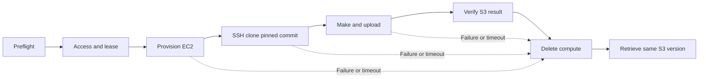

# AWS workspace workflow

The unattended workflow provisions one workspace, clones a pinned external
repository over SSH, invokes Make, verifies its uploaded result independently,
deletes compute and retrieves the same persistent S3 version again. Each run's
`result.json` records its native outcome; offline checks alone do not establish
AWS acceptance.

Run commands from the repository root. The accepted workspace uses `r8i.2xlarge`
(8 vCPUs, 64 GiB), a 60-minute absolute lease and termination five minutes early.
Native planning refreshes quota, network, image, identity and guard observations.
Another SKU/zone requires a reviewed source profile; no silent fallback occurs.

## Configure once

Use [the project configuration template](../../infra/aws/workspace.example.json)
as the shape of `evidence/aws/workspace.json`. It contains one target (temporary
profile, account, region, operator, deployer, backend and workload bucket), project,
workspace, repository/full revision, sizing and lease. Foundation and artifact
paths refer to existing retained evidence. Do not edit generated requests, tfvars
or terminal arguments. The old target registry is preserved; the configured
workflow uses only the target in this file.

`foundation.outputs_file` is a captured `tofu output -json` object with
`workspace_platform` and `workspace_guard` entries, bound by `outputs_sha256`.
The applied foundation receipt supplies its ownership and guard-code check.
Render is offline; planning still verifies live state, identity and guard coverage.
Use the deployed foundation. Do not recreate its backend or replay its plans.

Tool versions and download hashes come from
[versions.json](../../infra/aws/runner/workspace/toolbox/versions.json); the SDK
lock is its compiled, hashed dependency list. Rebuild changed toolbox artifacts
with `workspace-lifecycle.sh build NEW_DIRECTORY`. Retain earlier archives and
the deployed watchdog; rebuilding local artifacts does not deploy a guard.

The separate acceptance workload is `git@github.com:Bboissen/aws-workspace-e2e.git`,
with a full reviewed commit in the project configuration. Production Demo
code remains outside this repository. SSH uses a repository-scoped read-only
deploy key held in an existing regional Secrets Manager secret. Configuration
stores only its exact ARN, immutable version ID and public-key fingerprint.
The runtime helper fetches the raw OpenSSH private key through instance-role
credentials, uses a private RAM-backed directory and strict GitHub host trust,
checks the fingerprint and commit, then removes the credential on completion
or failure. Repository dependencies and Make execution remain external.

Before preparing an SSH runner, inspect and apply the separate `access` saved
plan using the same exact-review authorization interface below. Its scope is
the selected persistent project boundary's credential permission and the matching
job-document resource in the deployer grant.
Existing storage restrictions and every other platform input must remain intact.
This phase targets the selected boundary and the deployer policy. The deployer
change adds only the matching non-root job-document resource; its other grants
remain identical. The saved-plan review rejects every other mutation.
The runtime role gets the same exact-secret grant during normal preparation;
unrelated secrets remain denied. This is necessary because an attached allow
alone cannot override the old closed deny statements in either policy.
No secret value or new credential resource appears in an OpenTofu plan/state.

The secret permission also permits `kms:Decrypt` only through Secrets Manager
with the exact reviewed `SecretARN` encryption context and keys in the same
account/region. Direct KMS calls, unrelated contexts/keys and other cryptographic
actions remain denied. This removes the explicit deny that would otherwise block
even the AWS managed Secrets Manager key. Existing unchanged secret grants can
receive this narrowly reviewed decryption correction. Before compute, the
controller verifies both retrieval and decryption through native IAM simulation;
the real instance-role key retrieval is still required for job acceptance.

Access preparation is separate from the fresh launch lease. After applying it,
the configuration's foundation plan reference can point to that successful
`workspace-access` receipt; retain the previous configuration and all receipts.
Captured platform/guard output values remain unchanged by a boundary-only update.
Render a new run with a fresh lease before compute preparation/launch.

## Validate before cloud execution

```bash
rtk make check WORKSPACE_PYTHON=/path/to/locked/operator-venv/bin/python
rtk make historical-check
rtk bash tests/aws/test-workspace-installer.sh evidence/aws/tests/installer-NEW
```

The installer check executes the complete script in pinned local AL2023 with
systemctl stubbed. It downloads pinned public packages and contacts no AWS account
APIs. Its container and logs remain available under the new evidence directory.
The regular suite checks the complete production handoff with mocked OpenTofu
user-data and timezone-aware SDK dates, plus immutable configuration boundaries.

## Run an unattended E2E

The optional `job` configuration supplies a single Make target (`null` invokes
the repository default), a bounded timeout, dataset URI/version/SHA-256, and result
filename/hash plus provenance filename/dependency-lock hash. The dataset must be
in the selected regional bucket's project data namespace. The controller creates
a unique run ID and output prefix; callers do not reuse a result location.

```bash
export WORKSPACE_PYTHON=/path/to/locked/operator-venv/bin/python
rtk bash scripts/aws/workspace.sh evidence/aws/workspace.json preflight evidence/aws/preflight/NEW
rtk bash scripts/aws/workspace.sh evidence/aws/workspace.json run evidence/aws/runs/NEW \
  --authorization 'User authorized one bounded E2E launch, scoped access and compute cleanup'
rtk bash scripts/aws/workspace.sh evidence/aws/workspace.json status evidence/aws/runs/NEW --wait 60
```

`preflight` performs read-only storage, fixture, identity and deploy-key checks.
It validates the private key in RAM, removes it, and tests read access to the
pinned published commit without executing repository code locally.

`run` reviews each immutable saved plan against a closed mutation scope and
binds the supplied task authorization to its exact hashes before applying. It
automates access preparation, lease preparation, one EC2 launch, bootstrap/SSM
readiness, SSH clone and Make, independent result verification, retirement and
runner cleanup, then retrieves the same S3 result and provenance versions again.
The applied access receipt is saved in the operator configuration; its previous
configuration remains beside the run's evidence. Persistent buckets and the
existing watchdog are retained. No native launch retry occurs.
Scoped access plans retain a hash-bound dependency chain to the full platform
plan. Launch checks use that full plan for watchdog alarms and the launch
boundary, and reject changes to retained platform inputs or evidence.

The reviewed SSM command document clears the environment and uses `runuser`
before fetching the key or invoking the repository. Its grant scopes commands
to this document and the instance carrying the exact workspace, lease and guard
tags. The private key is removed before Make. The guest receives `AWS_REGION`,
`DATA_URI`, `DATA_VERSION_ID`, `DATA_SHA256`, `OUTPUT_URI` and `RUN_ID`, using
instance-role credentials. Dependencies, processing and result/provenance upload
belong to the external repository. Execution receipts and bounded logs are
uploaded separately by the toolbox.

Failure, timeout and ordinary interruption enter cleanup, including partial
preparation or launch. Cleanup independently refuses live compute before removing
the deadline and identities; the provider-side lifetime safeguard remains armed
if the controller disappears or AWS cleanup fails. `result.json` reports success
only when both result downloads match, compute/disk/interface absence is proven,
and persistent storage and the input fixture remain intact. Status observations
are bounded; immutable event and plan evidence remains under the run directory.



## Provision

Set `WORKSPACE_PYTHON` to the locked operator venv without resolving its symlink,
and add the pinned AWS CLI/Session Manager plugin to PATH. Select a fresh evidence
directory and an explicit future UTC start. All other choices come from the config.

```bash
export WORKSPACE_PYTHON=/path/to/locked/operator-venv/bin/python
project_config=evidence/aws/workspace.json
workspace_run=evidence/aws/runs/NEW
rtk bash scripts/aws/workspace.sh "$project_config" render "$workspace_run" \
  --starts-at YYYY-MM-DDTHH:MM:SSZ
rtk bash scripts/aws/workspace.sh "$project_config" plan "$workspace_run" prepare
```

Inspect the printed scope and `prepare/review.json` plus `prepare/plan.json`.
Record the existing task authorization against that exact review hash:

```bash
rtk bash scripts/aws/workspace.sh "$project_config" apply "$workspace_run" prepare \
  --review-sha256 REVIEW_HASH --authorization 'Authorized task and exact reviewed scope'
rtk bash scripts/aws/workspace.sh "$project_config" plan "$workspace_run" launch
rtk bash scripts/aws/workspace.sh "$project_config" apply "$workspace_run" launch \
  --review-sha256 REVIEW_HASH --authorization 'Authorized task and exact reviewed scope'
```

Review each saved plan before its apply. `prepare` creates only scoped identity,
terminal and deadline controls. `launch` creates compute only after the watchdog,
deadline, IAM and fresh heartbeat pass. The launch window is at most five minutes.
Apply never replans or extends the lease. Material changes to scope require review.

For initial SSH access preparation, use `plan RUN access` and `apply RUN access`
with the exact review hash and task authorization. An SSH `prepare` plan refuses
to proceed without a matching successful credential-boundary receipt. Access
plans cannot create compute, change storage or update watchdogs. The secret itself
is separately owned and retained; runner cleanup does not revoke the deploy key.

## Connect, clone and use S3

```bash
rtk bash scripts/aws/workspace.sh "$project_config" commands "$workspace_run"
rtk bash scripts/aws/workspace.sh "$project_config" connect "$workspace_run"
```

`commands` prints the exact configured clone command and S3 paths. Run those
commands inside the non-root `workspace` terminal. `connect` derives the launched
instance and terminal document, validates the production handoff, checks SSM and
guard health, then opens Session Manager. Reconnect with the same command and lease.

The external repository owns dependency installation and ML execution. Native S3
credentials come from the instance role. Use explicit `aws s3 cp` staging for
selected objects and upload durable results to the configured output prefix.
The bucket URI is not a filesystem mount; disposable disks are not synchronized.
The workspace identity cannot read state or unrelated namespaces.

## Tear down compute

Plan and apply `retire` with the same two commands used above, then plan and apply
`cleanup`, inspecting each exact review hash and scope. These stages terminate
the instance and remove disposable lease/identity controls. They retain workload
and state buckets, the persistent platform, IAM/alerts outside the runner scope,
and all evidence. Provider-native expiry remains active if bootstrap or access fails.

A failed/partial apply stops the happy path. Preserve its run and use the existing
[recovery runbook](aws-workspace-cd.md) to review the exact reconciliation scope;
do not rerun consumed plans or repeatedly launch another machine to debug a record.
AWS outages and the shared Lambda pool can delay expiry; retained storage still bills.

Initial platform creation is documented in [foundation setup](aws-workspace-fresh.md).
[Design and milestone history](aws-workspace-design.md) preserves earlier decisions.
